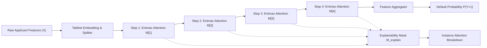

# LoanGuard AI — Explainable Loan Default Prediction Using TabNet

[](https://www.python.org/)
[](https://github.com/dreamquark-ai/tabnet)
[](https://streamlit.io/)
[](https://opensource.org/licenses/MIT)

> **Academic & Prototype Notice:**  
> **LoanGuard AI** is an educational demonstration project. It is **not** an operational automated credit decisioning engine. In production underwriting, regulatory standards (such as the Fair Credit Reporting Act, Equal Credit Opportunity Act, and EU GDPR) mandate exhaustive algorithmic audits, strict non-discrimination constraints, and verified counterfactual adverse action notices.

---

## 1. Project Overview & Problem Statement

Credit default prediction is a fundamental challenge in financial risk management. Traditional scoring systems rely either on linear scorecards (Logistic Regression) or gradient-boosted decision trees (XGBoost, LightGBM). While boosted trees offer strong predictive accuracy, they function as black boxes whose internal decision routing is opaque, often necessitating post-hoc surrogate methods like SHAP or LIME that are computationally demanding and approximate.

**LoanGuard AI** demonstrates the application of **Google Research's TabNet** architecture to consumer loan default forecasting. TabNet combines the gradient-descent optimization and representation-learning capabilities of deep neural networks with the inductive bias and interpretability of decision trees. 

Using native **sparse sequential attention masks ($\mathrm{entmax}_{1.5}$)**, the model exposes which applicant financial indicators are selected at each reasoning step, delivering transparent, instance-level explainability without surrogate post-hoc approximations.

---

## 2. Why TabNet for Tabular Credit Scoring?

Tabular data poses distinct challenges that historically caused standard deep Multi-Layer Perceptrons (MLPs) to underperform decision trees:
1. **Feature Sparsity & Hyperplane Routing:** Real-world credit risk is governed by localized, axis-aligned decision boundaries (e.g., "was the recent payment delayed by $\ge 2$ months?"), which tree partitions capture naturally.
2. **Dense Over-Parameterization:** Standard MLPs multiply all features across all layers simultaneously, making them prone to overfitting correlated noise.

TabNet resolves these issues through four key mechanisms:
- **Sequential Multi-Step Architecture:** The network evaluates an applicant across $N_{steps}$ consecutive decision steps.
- **Sparse Feature Selection:** In each step, an Attentive Transformer outputs a sparse mask $\mathbf{M}[i] \in [0, 1]^D$, driven by Entmax regularization, driving unselected feature weights strictly to zero.
- **Feature Reuse Regularization (Prior Scales):** A memory vector $\mathbf{P}[i]$ penalizes features that have already been extensively queried in previous steps ($\gamma = 1.3$), enforcing diverse, non-redundant feature exploration.
- **Native Interpretability:** The aggregate attention matrix $\mathbf{M}_{explain} = \sum_{i=1}^{N_{steps}} \mathbf{M}[i]$ is directly extracted during inference, showing the exact proportional attention dedicated to each financial metric.



---

## 3. Dataset & Preprocessing Pipeline

### Benchmark Dataset
- **Dataset:** UCI Default of Credit Card Clients Dataset (Yeh & Lien, 2009).
- **Population:** 30,000 credit card accounts from Taiwan (April – September 2005).
- **Target Variable:** `default_payment_next_month` (`1` = Default, `0` = Paid as agreed).
- **Target Imbalance:** Baseline default rate is **22.1%** (imbalanced classification).

### Input Features (23 Predictors)
- **Demographics:** `LIMIT_BAL` (credit limit), `AGE`, `SEX`, `EDUCATION`, `MARRIAGE`.
- **Repayment History (6 Months):** `PAY_0`, `PAY_2`, `PAY_3`, `PAY_4`, `PAY_5`, `PAY_6` (-2=Inactive, -1=Paid in full, 0=Revolving, 1-8=Months delinquent).
- **Bill Statement Balances:** `BILL_AMT1` to `BILL_AMT6` (statement balance in NT$).
- **Previous Payments:** `PAY_AMT1` to `PAY_AMT6` (payment made in NT$).

### Leakage-Safe Preprocessing
- **Stratified Partition:** Split into 70% Train (21,000), 15% Validation (4,500), and 15% Test (4,500).
- **Imputation & Scaling:** Missing numerical variables are imputed via medians; numerical features are scaled using `StandardScaler` **fitted exclusively on training data**.
- **TabNet Categorical Encoding:** Categorical features (`SEX`, `EDUCATION`, `MARRIAGE`) are integer-indexed contiguous sequences $[0, K-1]$ with explicit `cat_idxs`, `cat_dims`, and learnable entity embedding dimensions (`cat_emb_dim`).
- **Target Leakage Prevention:** Arbitrary identifiers (`ID`) are purged. Only indicators generated prior to the loan default observation window are included.

---

## 4. Model Architecture & Hyperparameters

| Hyperparameter | Configuration | Description |
| :--- | :--- | :--- |
| **Model Type** | `TabNetClassifier` | Deep neural network with sequential sparse attention |
| **`n_d`, `n_a`** | `16`, `16` | Width of decision prediction layer and attention layer |
| **`n_steps`** | `4` | Sequential decision and feature selection steps |
| **`gamma`** | `1.3` | Relaxation parameter enforcing feature diversity across steps |
| **`lambda_sparse`** | `1e-3` | Sparsity coefficient for Entmax entropy regularization |
| **`mask_type`** | `"entmax"` | 1.5-entmax sparse projection for exact zero-attention masking |
| **Optimizer** | `Adam(lr=0.02, weight_decay=1e-5)` | Gradient descent with L2 weight decay |
| **Scheduler** | `StepLR(step_size=10, gamma=0.9)` | Geometric learning rate decay |
| **Batch Size** | `1024` (Virtual: `128`) | Ghost Batch Normalization for training stability |
| **Imbalance Handling** | `weights=1` | Dynamic balanced loss weighting proportional to class ratio |
| **Early Stopping** | `10` epochs patience | Monitored on validation ROC-AUC |

---

## 5. Explainability: Scientific Methodology & Limitations

### What TabNet Explainability Establishes
TabNet's `model.explain(X)` outputs the exact routing tensors computed by its attentive transformers:
1. **Aggregated Instance Mask:** Proportional focus the model placed on each feature for that specific applicant.
2. **Step-by-Step Masks:** Sequential order of inspection (e.g., Step 1 examines recent payment status `PAY_0`, Step 2 cross-checks bill statement vs limit ratio).

### Critical Scientific Caveats: Attention vs. Causality
> [!IMPORTANT]  
> **Attention weights do NOT represent causal impact.**  
> - An attention weight of 42% on `PAY_0` means the neural network routed significant computational capacity through the applicant's September payment status.  
> - It does **not** prove that September payment status caused the default.  
> - TabNet attention masks are unsigned non-negative magnitudes $[0, 1]$. They indicate **salience**, not directionality (i.e., they do not state whether a feature increased or decreased default probability). Directional causal claims require valid counterfactual interventions or structural causal models (SCMs).

---

## 6. Installation & Setup Guide

### Prerequisites
- Python 3.10, 3.11, 3.12, or 3.14.
- Windows PowerShell, macOS zsh, or Linux bash.
- Recommended: VS Code with Python extension.

### Setup Commands (Windows PowerShell)

```powershell
# 1. Clone or navigate to the repository
cd C:\Users\Naman\.gemini\antigravity\scratch\loanguard-ai

# 2. Create Python virtual environment
python -m venv .venv

# 3. Activate the virtual environment
.\.venv\Scripts\Activate.ps1

# 4. Upgrade pip and install all required packages
pip install --upgrade pip
pip install -r requirements.txt
```

*(On macOS/Linux, replace step 3 with `source .venv/bin/activate`)*

---

## 7. How to Run the Project

### Step 1: Train the Models
Trains the PyTorch TabNet model and baseline models (Logistic Regression, Random Forest), fits the preprocessing pipeline, and caches held-out test data:
```powershell
python src/train.py
```

### Step 2: Evaluate Models & Generate Reports
Evaluates all models on the held-out test split (4,500 records) and generates confusion matrices, ROC curves, and PR curves:
```powershell
python src/evaluate.py
```

### Step 3: Run Automated Unit Tests
Executes the comprehensive test suite verifying preprocessing consistency, leakage safety, output ranges, and TabNet explanation matrices:
```powershell
pytest
```

### Step 4: Launch the Streamlit Web Application
Starts the multi-page fintech dashboard on `http://localhost:8501`:
```powershell
streamlit run app.py
```

---

## 8. Web Application Walkthrough

The Streamlit interface provides a fintech-grade dark navy dashboard organized into five dedicated views:

```
loanguard-ai/
├── app.py                      # Home Dashboard (Executive Summary & TabNet Primer)
└── pages/
    ├── 1_Applicant_Prediction.py # Interactive Credit Scoring & Per-Applicant Attention
    ├── 2_Model_Performance.py   # Benchmark Comparison Table, ROC/PR Curves, CM
    ├── 3_Explainability.py      # Global Importance & Sequential Multi-Step Heatmaps
    └── 4_Dataset_Explorer.py    # Portfolio Demographics, Statement Distributions & PII Notice
```

1. **Home Dashboard (`app.py`):** Executive status cards, TabNet deep learning primer, and live key performance indicators.
2. **Applicant Prediction (`pages/1_Applicant_Prediction.py`):** Interactive credit application form with benchmark persona presets (Prime Low-Risk, Moderate Revolver, High-Risk Delinquent). Displays default probability, risk tier badge, and individual horizontal attention bar charts.
3. **Model Performance (`pages/2_Model_Performance.py`):** Side-by-side benchmark table comparing TabNet against Scikit-Learn Logistic Regression and Random Forest. Interactive Plotly ROC and Precision-Recall curves. Detailed explanation of why accuracy is misleading under 22% class imbalance.
4. **Explainability (`pages/3_Explainability.py`):** Global feature importance ranking and interactive test-set applicant picker displaying 4-step sequential attention heatmaps.
5. **Dataset Explorer (`pages/4_Dataset_Explorer.py`):** Portfolio demographic analysis, distribution histograms by default status, and data schema dictionary.

---

## 9. Directory Structure

```
loanguard-ai/
├── app.py                      # Main Streamlit entry point
├── config.py                   # Central hyperparameters, schemas, and paths
├── requirements.txt            # Pinned Python package dependencies
├── pytest.ini                  # Pytest runner configuration
├── .gitignore                  # Git exclusions for checkpoints and cache
├── README.md                   # Comprehensive documentation
├── data/
│   ├── README.md               # Dataset documentation, license, and schema
│   ├── default_of_credit_card_clients.csv # Local sanitized dataset
│   └── test_set_cache.parquet  # Cached held-out test split (4,500 samples)
├── models/
│   ├── README.md               # Model persistence documentation
│   ├── preprocessor.joblib     # Fitted TabNetDataPreprocessor
│   ├── tabnet_model.zip        # PyTorch TabNetClassifier checkpoint
│   ├── baseline_lr.joblib      # Scikit-Learn Logistic Regression baseline
│   └── baseline_rf.joblib      # Scikit-Learn Random Forest baseline
├── reports/
│   ├── README.md               # Reports documentation
│   ├── evaluation_metrics.json # Empirical test evaluation results
│   └── global_feature_importance.json # Normalized feature attention scores
├── src/
│   ├── __init__.py             # Package marker
│   ├── data_loader.py          # UCI fetcher with synthetic fallback
│   ├── preprocessing.py        # TabNetDataPreprocessor (leakage-safe)
│   ├── train.py                # TabNet + Baseline training script
│   ├── evaluate.py             # Evaluation & curve extraction script
│   ├── predict.py              # Single-applicant and batch inference
│   ├── explain.py              # Native TabNet explainability extractor
│   └── ui_components.py        # Custom CSS and Plotly styling helpers
└── tests/
    ├── conftest.py             # Sys.path configuration
    ├── test_preprocessing.py   # Preprocessor consistency tests
    └── test_prediction.py      # Inference output and explainability tests
```

---

## 10. Future Improvements
- **SHAP TreeExplainer Comparison:** Integrate TreeSHAP on the Random Forest baseline to compare TabNet attention masks against Shapley values.
- **Fairness & Bias Auditing:** Implement Fairlearn to measure demographic parity and equalized odds across demographic subgroups (`SEX`, `MARRIAGE`).
- **Probability Calibration:** Add Isotonic Regression or Platt scaling to calibrate predicted default probabilities to true portfolio default rates.
- **Microservice API:** Wrap inference in FastAPI with Docker containerization for deployment in Kubernetes clusters.
